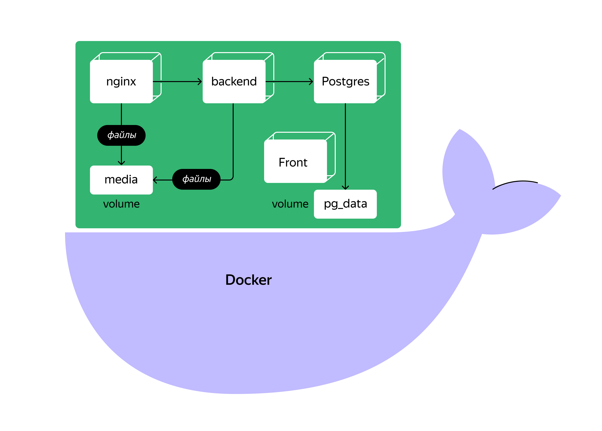

# Kittygram

## Описание проекта

Kittygram — это веб-приложение, где пользователи могут делиться фотографиями своих котиков, добавлять достижения и просматривать котиков других пользователей.

Проект контейнеризирован с использованием Docker и развёртывается с помощью CI/CD через GitHub Actions.

## Технологии

- Python
- Django + Django REST Framework
- PostgreSQL
- React (фронтенд)
- Gunicorn
- Nginx
- Docker / Docker Compose
- GitHub Actions (CI/CD)

## Установка и запуск

### 1. Клонирование репозитория

```bash
git clone https://github.com/ad725/kittygram_final.git && cd kittygram_final
```

### 2. Настройка переменных окружения
Создайте файл .env в корне проекта:

```bash
nano .env
```
Пример содержимого:
```
# PostgreSQL
DB_ENGINE=postgresql
POSTGRES_DB=django
POSTGRES_USER=django_user
POSTGRES_PASSWORD=mysecretpassword
DB_HOST=db
DB_PORT=5432

# Django
SECRET_KEY='django-insecure-sample'
DEBUG=False
ALLOWED_HOSTS=localhost,158.160.223.19,hopto.hopto.org

# Docker
DOCKER_USERNAME=ad725
```

### 3. Запуск через Docker Compose

```bash
sudo docker compose -f docker-compose.production.yml up -d
```

## Архитектура приложения в контейнерах:



## Авторы проекта

[Дмитрий Меховых](https://github.com/ad725)